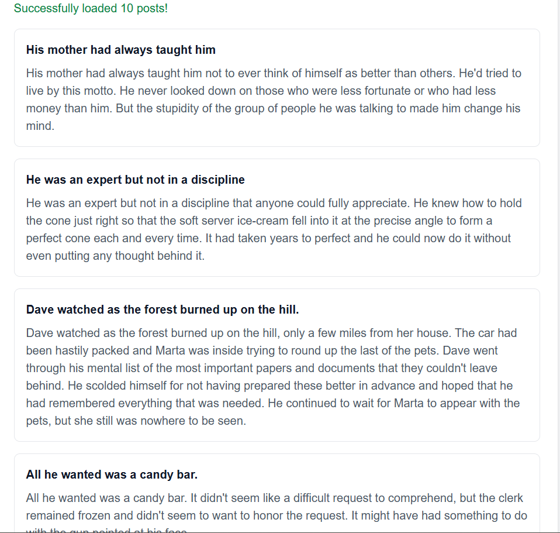
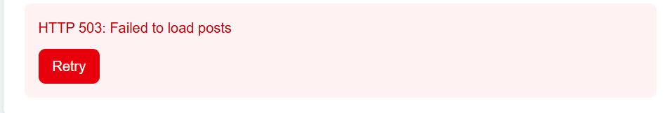
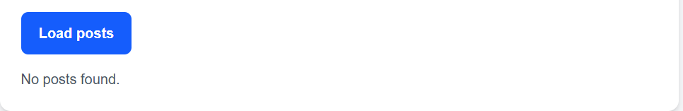
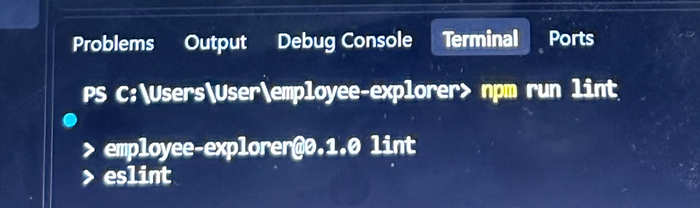
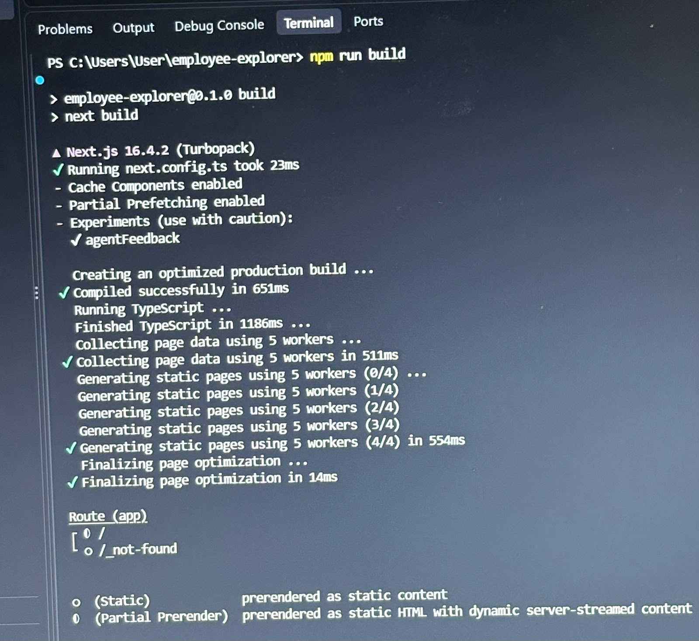

# Assignment 3 – Testing Report

**Developer:** Sally Kadi  
**Project:** Employee Explorer  
**Framework:** Next.js with TypeScript  
**Original Testing Date:** October 21, 2026  
**Review Update:** October 30, 2026

## 1. Testing Environment

- **Browser:** Google Chrome
- **Development server:** http://localhost:3000
- **Testing method:** Manual browser testing
- **Employee API:** JSONPlaceholder
- **Posts API:** DummyJSON (updated after initial testing)

The employee profile and posts use separate demonstration APIs. The DummyJSON posts are sample content and should not be interpreted as posts authored by the displayed employee.

## 2. Manual Test Results

| Test | Expected Result | Observed Result | Status |
|---|---|---|---|
| Employee Profile | Display employee information | Name, email and company displayed | PASS |
| Recent Posts | Display first three API posts | Three API posts displayed | PASS |
| Success | Load 10 posts | Ten posts displayed; screenshot captured | PASS |
| Slow Response | Display loading, then posts | Loading state observed; screenshot captured | PASS |
| HTTP 503 | Display HTTP error and Retry | HTTP 503 message and Retry button appeared | PASS |
| Empty Response | Display empty message | No posts found appeared | PASS |
| Retry after Error | Repeat selected scenario | Console confirmed two loadPosts calls: initial load and Retry; HTTP 503 displayed again | PASS |
| Suspense Fallback | Show independent loading state | Observed during initial testing | PASS – ORIGINAL TEST |
| Profile Request Failure | Display local error without breaking posts | Profile HTTP 503 message appeared while Recent Posts remained visible | PASS |
| Recent Posts Request Failure | Display local error without breaking profile | Recent Posts HTTP 503 test completed | PASS |

The original client tests were completed before changing the posts API. The updated implementation was subsequently checked in the browser, and client scenario screenshots were captured.

## 3. Updated Error Handling

The application uses a custom `ApiError` class extending JavaScript's `Error` class.

The class stores the HTTP status and uses `super(message)` to initialize the inherited error message.

After receiving a response, the application checks `response.ok` before parsing JSON.

The catch handling distinguishes:

- HTTP errors using `ApiError`.
- Network-related failures using `TypeError`.
- Other unexpected errors.

## 4. Client Response Simulation

### Success

The original implementation fetched posts from JSONPlaceholder.

The updated implementation fetches English-language sample posts from DummyJSON and renders the actual `post.title` and `post.body` fields.

**Observed result:** Successfully loaded 10 posts.

**Result:** PASS.

### Slow Response

The client includes a two-second simulated delay before requesting posts.

**Observed result:** A loading message appeared during the simulated delay.

The delay is configured as 2000 milliseconds in the code. It was not independently measured with a timer.

**Result:** PASS for the observed loading state.

### HTTP 503 Error

The application creates a local `Response` object with HTTP status 503.

This response passes through the same `response.ok` validation as an actual API response.

The application throws `ApiError` when the response is unsuccessful.

**Observed:** HTTP 503 message and Retry button appeared.

**Result:** PASS.

### Empty Response

The application creates a successful local `Response` containing an empty posts collection.

The DummyJSON implementation uses the response structure `{ posts: [] }`.

The response passes through the same JSON parsing and validation path as a successful API response.

**Observed:** No posts found.

**Result:** PASS.

### Retry

Retry repeats the currently selected scenario.

The Retry button calls the same `loadPosts()` function as the Load posts button.

A temporary console log was added to verify that the function executed again.

**Observed in the browser console:**

```text
Load posts triggered: error
Load posts triggered: error
```

The first message came from clicking Load posts. The second appeared after clicking Retry.

Because HTTP 503 is the selected scenario, the same error is expected to appear again.

The temporary console logging was removed from the final source code.

**Result:** PASS.

## 5. Independent Server Sections

The Employee Profile and Recent Posts use separate Suspense boundaries.

Expected request failures are caught locally and converted into section-specific messages.

### Employee Profile Failure

A temporary HTTP 503 response was used to test the profile section.

**Observed:** The Employee Profile displayed an HTTP 503 error while Recent Posts continued displaying content.

**Result:** PASS.

### Recent Posts Failure

A temporary HTTP 503 response was used to test Recent Posts.

**Result:** PASS – temporary failure test completed.

Both files were subsequently restored to their normal API-fetching implementations.

These tests demonstrate that an expected request failure in one server section does not automatically prevent the other section from rendering.

## 6. Code Quality Checks

| Command | Result |
|---|---|
| `npm run lint` | PASS – no reported errors |
| `npm run build` | PASS – production build completed |
| TypeScript compilation | PASS |

These results were observed in the local terminal on October 30, 2026.

The commands should be rerun after the final source changes to reconfirm the final version.

## 7. Screenshot Evidence

The following screenshots were captured during manual testing and uploaded to the `assignment-3-maya-interview` branch.

### Client Scenario Evidence

**Successful Response**



The application successfully loaded 10 posts and displayed their returned titles and bodies.

**Slow Response**


The loading message was displayed during the simulated two-second delay.

**HTTP 503 Error**



The simulated HTTP 503 response displayed an error message and a Retry button.

**Empty Response**



The simulated empty response displayed "No posts found."

### Code Quality Evidence

**ESLint**



The `npm run lint` command completed without reported errors.

**Production Build**



The `npm run build` command completed successfully.

### Independent Server Failure Evidence

The Employee Profile and Recent Posts HTTP 503 scenarios were tested separately.

Screenshots of these two server-section failures have not yet been added to this evidence folder.

## 8. Corrections After Review

The initial implementation used plain `Error` objects and directly simulated failure and empty states.

Following the review, the implementation was corrected to:

- Use `ApiError extends Error`.
- Preserve HTTP status information.
- Process simulated responses through the normal response-handling path.
- Render actual API post titles and bodies.
- Handle server-section errors locally.
- Change the client slow simulation from three seconds to two seconds.
- Separate data-loading error handling from JSX rendering to satisfy lint requirements.

The posts API was also changed to DummyJSON to display more readable English-language sample content.

The original predictions and observations remain documented rather than being rewritten as though the corrected implementation existed from the beginning.

## 9. Known Limitations

- JSONPlaceholder and DummyJSON provide demonstration data from different sources.
- HTTP 503 and Empty scenarios are simulated locally.
- Retry repeats the selected scenario, including the selected error.
- No automated test suite has been added.
- The two independent server failure tests do not yet have screenshot evidence.
- The simulated two-second delay was verified in code but not independently timed.

## 10. Conclusion

The assignment now includes custom HTTP error handling, shared response-processing logic for simulated failures, independent server-section error handling, and rendering of actual API post fields.

Independent Profile and Recent Posts failure simulations were completed.

The client scenarios, including Retry, were tested manually.

Lint and production build checks passed before the latest documentation update. Final checks and Git push remain to be completed.
